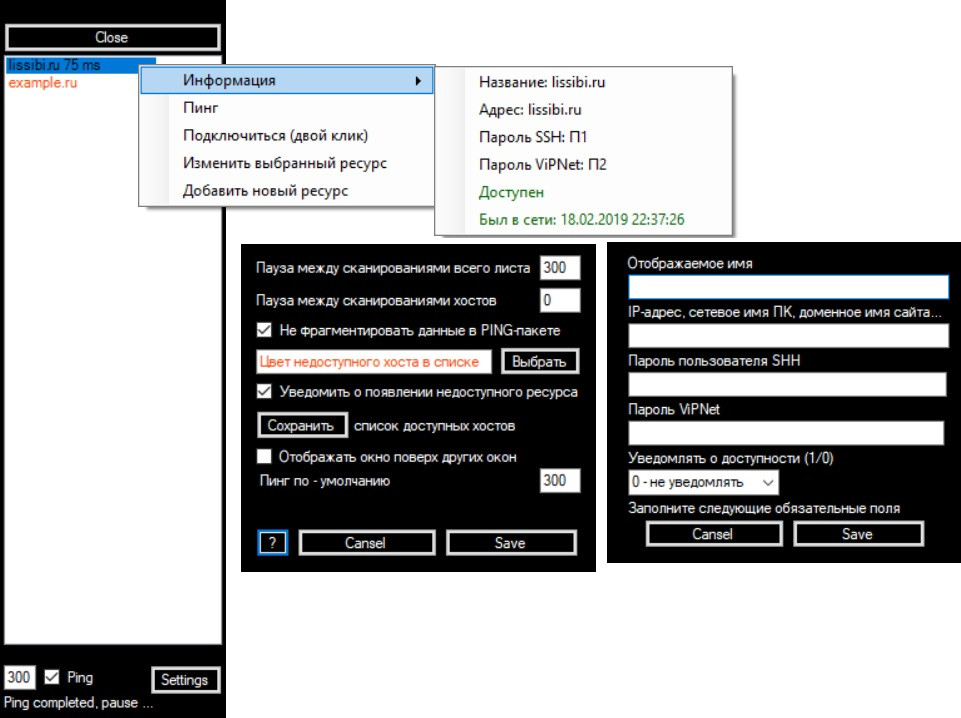

# Putty_starter
## Description
Программа предназначена для максимально компактного отображения доступности по ICMP часто используемых хостов с возможностью быстрого подключения по SSH.

## Screenshot
